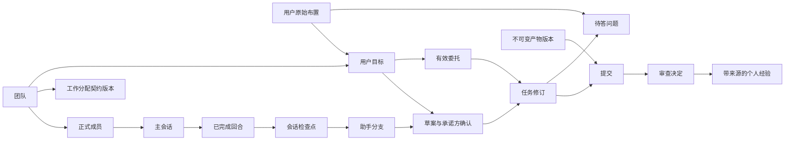

# 多智能体平台领域模型

本模型供协作服务、会话运行时、网页与评测程序共同使用。术语的项目含义见[详细需求](requirement.md)，数据落库与恢复契约见[运行时对接](runtime-contract.md)。

## 业务对象之间的关系

同一团队每次有一个活动目标，可有多个排队目标。活动目标结束后通知 Lead，由 Lead 按排队顺序激活最早满足前置条件的目标。一个目标可有多项独立或相互依赖的工作。每项生效委托有一个当前负责人、一个派发者和一个主审，三种身份由实际角色承担。Lead 是团队中的正式成员。新增正式成员获得稳定身份、契约边界和独立工作区。助手归属一位父代理及活动目标内的一项工作范围，可服务首次委托协商或既有任务，由父代理向上游签收与交付。各范围的权限通过显式交接取得。

### 三种需要分开追踪的变化

| 变化 | 怎样追溯 |
|---|---|
| 团队改变长期分工 | 新契约版本指向上一版和 Lead 的裁决。已经生效的任务保留当时承诺，需改动时走任务修订。 |
| 双方形成或改变本次交付 | 首次草案关联活动目标及协商范围。修订草案还关联任务和基础修订。全部承诺方确认同一版本后，正式角色的主代理可在授权范围内登记唯一任务或下一修订。当前负责人唯一，并发认领只有一次生效。 |
| 作者修复已发布材料 | 同一逻辑产物有多个不可变版本。每次提交固定需求修订、所交版本和验证证据。退回后的新提交指回前次提交。 |

## 状态与负责方

| 对象 | 正常迁移 | 异常与恢复 |
|---|---|---|
| 用户目标 | 已布置 → 已登记并排队或活动 → 可交付 → Lead 关闭 | 登记前可先澄清。失败、超时、用户终止保留原始布置与终止时间及原因。目标验收约定的当前修订列出必需交付及对应任务和审查。必需交付仍待验、受阻或材料不可读时，成功结案条件尚未满足。 |
| 委托草案 | 拟议 → 待确认 → 全部确认 → 已登记 | 可反提议、拒绝、撤回，所属范围终止时关闭未登记草案。改条款产生新草案版本，各版本保留自己的确认记录。过期基础修订要求重新核对。 |
| 有效任务 | 等待依赖或就绪 → 执行 → 待验 → 通过 | 执行中可等待人。退回进入返工，重新提交再待验。确需结束时保留失败或终止事实。依赖变化仅重开受影响的下游复核。 |
| 真人问题 | 已登记 → 待答 → 有效答复已投递 | 可先于目标登记，记录对应的原始请求或受阻工作。每个问题至多一个生效答复。答复只解除有效范围内的对应阻塞，其他阻塞清空后才恢复执行。 |
| 会话回合 | 排队 → 运行 → 完成 | 中断或结果不明时持久化已有动作并核对。完成回合有稳定历史位置，可作为分支起点。 |
| 助手委托 | 创建 → 排队或执行 → 返回材料 → 父代理采用或退回 → 结束 | 支持等答案、取消和预算耗尽。协商或任务结束、目标终止或撤权后停止该范围的执行，保留来源与采用记录。 |
| 评测记录 | 原始布置消息落库时开始 → 逐次登记承诺和通过事实 → 交付或终止时冻结 | 失败及登记前终止的布置仍进入目标分母。另行评阅可追加评价来源和日期。 |

## 跨对象约束

1. **身份和可见性。** 群、目标、任务、附件及参与者必须属于同一授权范围。点名决定投递人，范围决定读者。Lead 的进度通知只含可公开摘要。私聊的正文、附件、衍生摘要、检索命中、助手交接和导出均继承来源限制。
2. **历史和授权。** 一个检查点对应一个确定的已完成回合。多个分支可以引用同一检查点，各自拥有后续历史与可写空间。父代理后续发言仅进入自己的时间线，任务修订经显式通知送达当前执行者。继承材料需在创建时可授权、读取时仍有权访问。
3. **承诺与决定。** 助手返回的草案须由有权的正式成员确认。变更他人职责须得到相应承诺方确认。专家可以接受同一交付计划并保留不同判断，验收回执准确标识其接受的内容。
4. **依赖与验收。** 父子关系表达谁向上游负责；前置关系表达工作需要哪些输入。两者分别校验无环。输入交接指向具体版本，审查指向当时提交。旧版通过记录继续可查，现行结案采用当前有效提交。
5. **知识与评价。** 个人经验归属一名成员，关联来源、适用条件、后续使用和可观察结果，默认由本人读取。其他参与者按显式交接与来源授权读取获准条目。一个场景可以复用已发布版本及获准经验，新的目标独立计算成功与耗时。对话质量评阅保留评阅者与依据。
6. **终止与迟到结果。** 关闭或终止释放对应工作范围，仍关联其他有效工作的事项保留其有效关联。迟到答复、模型结果和工具回执只用于历史追溯或外部结果核对。任务效力、目标终态和已冻结计数以终止时记录为准。

## 验证这些关系的三个例子

- 同一助手在草案版本 2 上取得某位主代理的确认。另一方修改验收条件并发布草案版本 3，两个版本的确认各自独立，版本 3 的承诺方须对当前条款作出决定。
- 一次推送审批固定目的仓库、分支、提交和动作。执行回执引用该批准及实际远端状态，超时核对沿用同一组身份和版本。
- 运行报告引用指标定义版本、目标终止时间、冻结的生效委托集合及其验收结果。外部评阅者的质量标签另存评阅来源与证据，可与平台完成率并列分析。
